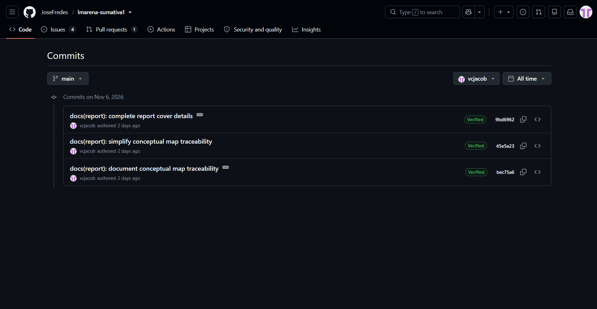
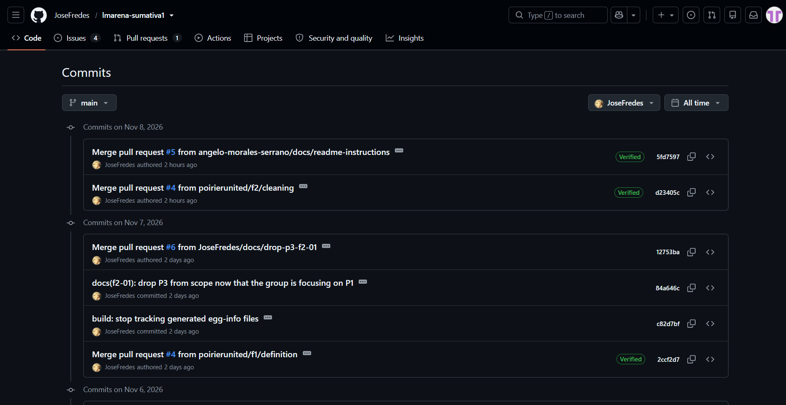
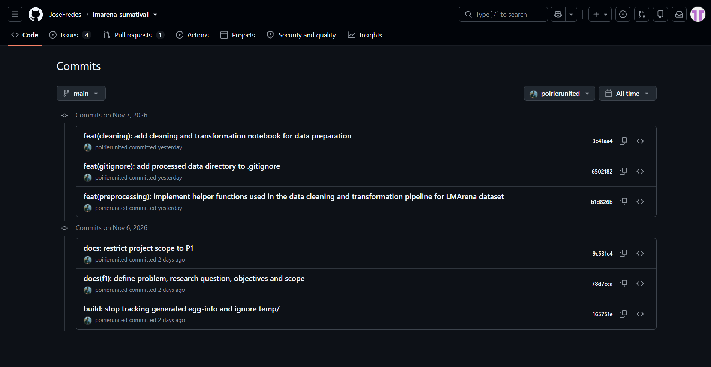
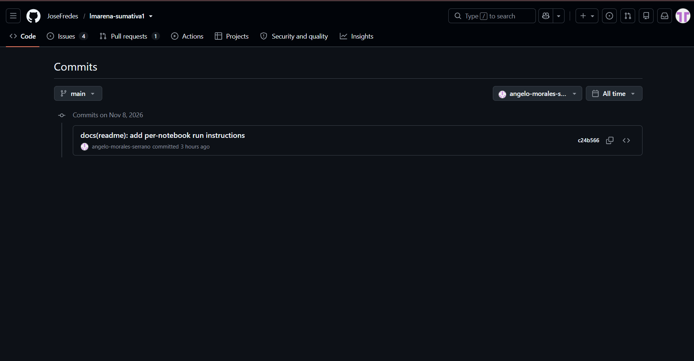
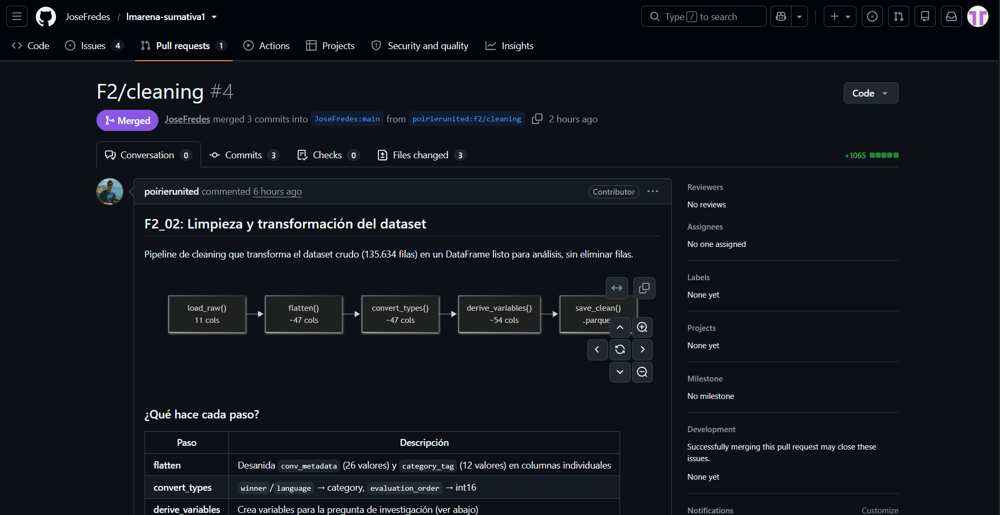
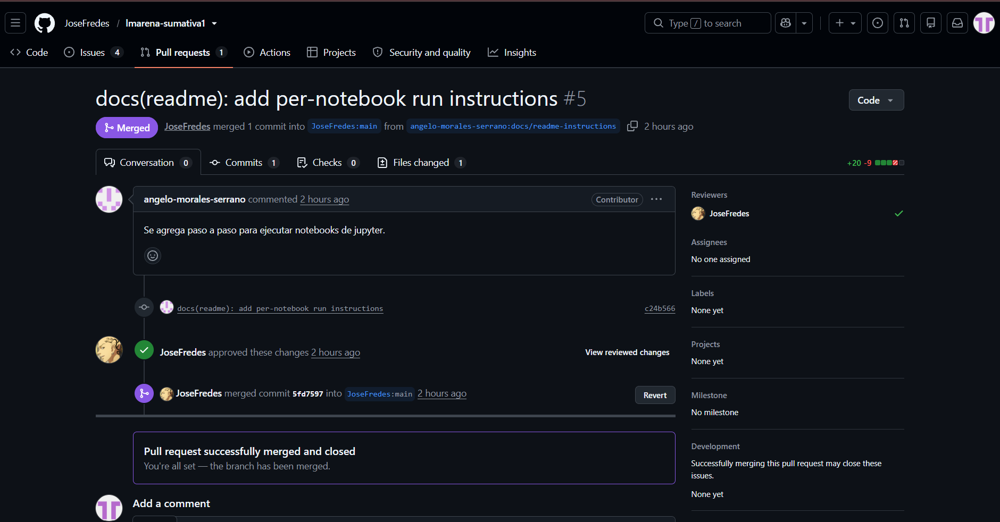

# Informe técnico · Avance del proyecto, Fases 1 y 2

> **Borrador de trabajo.** Sigue el orden y la numeración de la guía de desarrollo de la Sumativa 1 (apartados 4.1 a 4.15) para que el índice del informe final coincida con lo que pide la rúbrica.
<!-- REVISIÓN FINAL ANTES DE LA ENTREGA:
Cuando el informe esté aproximadamente al 90% de avance, actualizar y verificar la información de todas las secciones.
Revisar especialmente cifras, resultados, estado de los notebooks, contribuciones, commits, Pull Requests, bibliografía y evidencias del repositorio.
Confirmar que las capturas correspondan a la versión definitiva del proyecto.
-->
> Estado de cada apartado: ✅ redactado · 🟡 redactado con datos pendientes · ⬜ por redactar.
> Marcas: `[PENDIENTE]` depende de trabajo aún no hecho; `TODO(humano)` lo debe completar el grupo; `[VERIFICAR]` es un dato que hay que confirmar antes de entregar.
> Este texto es un punto de partida: cada integrante debe leerlo, corregirlo y dejarlo en su propia voz, porque el informe debe ser de elaboración propia.

---

## 1. Portada e índice · 🟡

| Campo | Contenido |
|---|---|
| Curso y código | MCDI500 · Programación para la Ciencia de Datos (sección MCDI500.202683.1529.EL.ON) `[VERIFICAR]` |
| Programa | Magíster en Ciencia de Datos e Inteligencia Artificial · Universidad Andrés Bello |
| Título del proyecto | ¿Contenido o formato? Preferencias humanas en LMArena |
| Subtítulo | Avance del proyecto, Fases 1 y 2 |
| Integrantes | Alejandro Poirier Gomez, Angelo Morales Serrano, Jose Fredes Acevedo y Valentina Carvajal Jacob |
| Grupo | 6 |
| Docente responsable | Dr. Omar Salinas Silva |
| Fecha | 8 de noviembre de 2026 |
| Repositorio | https://github.com/JoseFredes/lmarena-sumativa1 |

**Índice:** automático, generado desde los estilos de título (Título 1, 2 y 3) y actualizado justo antes de exportar. Los apartados son los de este documento, en el mismo orden.

**Observaciones sobre la plantilla institucional** (`f1_s01_evaluacion_entregable.docx`), a resolver antes de entregar:
- Dice "MCDIA500" y "AVANCE DEL PROYECTO FASE 1"; la entrega cubre las Fases 1 y 2 y el curso se llama MCDI500.
- La plantilla original solo contempla "Nombre integrante/s", "Curso" y "Fecha". En esta portada se agregaron el título del proyecto, docente, grupo y enlace al repositorio. Revisar si faltan otros datos institucionales solicitados.
- La lista de "Apartados" no incluye codificación funcional, preprocesamiento, validación técnica ni los notebooks de la Fase 2.
- No trae índice automático ni estilos de título: hay que agregarlos.
- Nombre del archivo: la instrucción pide `f1_s01_evaluacion_entregable_grupox` y a la vez "no superar los 20 caracteres", lo que es incompatible (el nombre base ya tiene 35). Consultar al docente.

La estructura y el orden de los apartados del informe siguen lo indicado en la guía de desarrollo de la Sumativa 1 (*Guía de desarrollo — Evaluación Sumativa 1 (Fases 1 y 2)*, s. f.).

---

## 2. Introducción y contextualización · ✅

Los modelos de lenguaje de gran tamaño se comparan cada vez más mediante evaluaciones basadas en preferencia humana: una persona formula una pregunta, recibe dos respuestas anónimas de modelos distintos y vota por la que prefiere. La plataforma más conocida de este tipo es Chatbot Arena, hoy LMArena, descrita por Chiang et al. (2024) como una plataforma abierta que recoge comparaciones por pares de forma masiva. Sus resultados se utilizan para ordenar modelos y, en la práctica, para decidir cuáles se adoptan.

Ese uso supone que el voto refleja la calidad de la respuesta. Sin embargo, también podría reflejar su estilo: una respuesta más larga o con más listas, encabezados y negritas puede parecer mejor sin serlo. La literatura ya documenta sesgos de este tipo. Dubois et al. (2024) muestran que los evaluadores automáticos favorecen respuestas más largas y proponen corregirlo, y Wu y Aji (2025) encuentran que anotadores colectivos, expertos y modelos pueden calificar mejor respuestas con errores factuales que respuestas cortas o con errores gramaticales. Si un sesgo de forma afecta los rankings, estos miden mal la capacidad real de los modelos, lo que constituye un problema de evaluación y, por extensión, de seguridad: se podrían desplegar o promover modelos por su apariencia y no por su fiabilidad.

Este proyecto estudia esa situación con el conjunto de datos público `lmarena-ai/arena-human-preference-140k` (LMArena, 2025), que reúne 135.634 votos humanos emitidos entre el 17 de abril y el 24 de julio de 2025, con 53 modelos y 126 idiomas. Las preguntas que orientan el proyecto son dos: si el lado ganador tiende a ser el de respuesta más larga y con más formato (estilo frente a calidad), y si la posición en que se presenta el modelo o el orden del voto dentro de la sesión se asocia al resultado (sesgo de posición y de sesión).

El **objetivo general** del proyecto es construir y validar un conjunto de datos reproducible que permita analizar si las características de estilo y de presentación se asocian a la preferencia humana en LMArena. El alcance de este informe se limita a las Fases 1 y 2: definir el problema, dejar el entorno reproducible y preparar el dato. El análisis se reserva para las fases siguientes.

La problemática requiere un enfoque basado en programación y análisis de datos por tres razones: el volumen (más de 135 mil filas en 7 archivos de 1,6 GB en total), la estructura (columnas anidadas que deben aplanarse) y la heterogeneidad (idiomas, longitudes muy asimétricas y votos agrupados en sesiones). Nada de esto puede revisarse a mano ni de forma reproducible sin código.

Las fases del proyecto se articulan así: la **Fase 1** define el problema y configura el entorno; la **Fase 2** obtiene, explora, limpia, transforma y valida el dato; la **Fase 3** analiza las asociaciones planteadas con incertidumbre; y la **Fase 4** integra los resultados, concluye y discute sus implicancias para la evaluación de modelos.

---

## 3. Definición de la problemática y objetivos · ✅

### 3.1 Problemática
Las evaluaciones por preferencia humana se usan como medida de calidad de los modelos de lenguaje, pero su resultado puede depender de factores ajenos al contenido: la longitud de la respuesta, su formato (listas, encabezados, negritas), la posición en que se muestra (lado A o B) y el momento de la sesión en que se vota. Se desconoce cuánto pesa cada factor en datos recientes y cómo varía entre tipos de prompt e idiomas.

### 3.2 Preguntas del análisis
- **Pregunta central.** ¿En qué medida las preferencias humanas registradas en LMArena se asocian a características de estilo y de presentación de la respuesta, y no solo a su contenido?
- **P1 · Estilo frente a calidad.** ¿El lado ganador tiende a ser el de respuesta más larga y con más formato? ¿Cambia según categoría de prompt, idioma o modelo?

Estas preguntas se responden en las Fases 3 y 4.

### 3.3 Objetivo general
Construir y validar un conjunto de datos reproducible que permita analizar si las características de estilo y de presentación se asocian a la preferencia humana en LMArena.

### 3.4 Objetivos específicos
1. **OE1.** Configurar un entorno reproducible y un repositorio versionado, verificable mediante `make install` y la ejecución de las pruebas automáticas.
2. **OE2.** Obtener los 7 archivos del dataset con verificación de integridad (SHA-256) y documentar su estructura real: columnas, tipos, nulos y cardinalidades.
3. **OE3.** Limpiar y transformar el dato: aplanar las columnas anidadas, tipificar, tratar casos atípicos y duplicados, derivar variables de estilo y de posición, y escalar las que lo requieran, justificando cada decisión con una medición.
4. **OE4.** Validar el conjunto resultante con chequeos automáticos y pruebas unitarias que cubran casos normales, límite y excepciones.
5. **OE5.** Dejar documentadas las limitaciones y el dataset procesado como entrada directa de la Fase 3.

### 3.5 Alcance
**Se aborda:** definición del problema; entorno y repositorio; obtención, exploración univariada, limpieza, transformación y validación del dato; muestreo para pruebas.
**No se aborda en este informe:** comparaciones entre ganadores y perdedores, tasas de victoria por modelo, pruebas de hipótesis, intervalos de confianza, modelos predictivos y análisis de tendencias temporales. Quedan proyectados para las Fases 3 y 4.

### 3.6 Restricciones
Condiciones impuestas por el dato o por el contexto, distintas de las decisiones de alcance:
- **Ventana temporal:** los datos cubren cerca de 3 meses (17 de abril a 24 de julio de 2025) y la recolección es despareja: abril es parcial y hay días con 330 votos y otros con 2.865.
- **Estructura de sesiones:** el 79,9 % de los votos es el primero de su sesión y solo el 11,4 % de las sesiones tiene más de un voto, lo que limita el análisis del efecto del orden.
- **Definiciones faltantes:** la ficha del dataset no define la diferencia entre `tie` y `both_bad` ni documenta el método de las etiquetas de categoría, que son automáticas.
- **Tamaño:** el dato original pesa 1,6 GB, por sobre los 100 MB sugeridos; no se versiona y se descarga con verificación de integridad.
- **Licencia:** los prompts son CC-BY-4.0; las respuestas de los modelos dependen de cada proveedor, por lo que no se redistribuyen.
- **Datos personales:** los prompts son texto libre de personas reales y no es posible asegurar que carezcan de datos identificables. Solo se utiliza su longitud y no se publica ningún texto.
- **Herramientas del curso:** en las Fases 1 y 2 se usan NumPy, pandas, matplotlib y pyarrow; scikit-learn y SciPy se reservan para la Fase 3.

### 3.7 Supuestos
- La ficha de Hugging Face describe correctamente las columnas; las diferencias detectadas con el dato real se documentan (por ejemplo, `conv_metadata` trae 26 valores y no un conteo único por variable).
- Los conteos de `conv_metadata` (tokens, encabezados, listas, negritas) miden con fidelidad el estilo de cada respuesta.
- Un voto `model_a` o `model_b` expresa una preferencia real del votante.
- Las filas de una misma sesión no son independientes; cualquier análisis posterior debe considerarlo.
- El estudio es observacional: se hablará de asociaciones y no de causas.
- El dataset no tiene valores faltantes en las 11 columnas cargadas (se verifica en la Fase 2); su “suciedad” se encuentra en los ceros, los valores extremos, los idiomas no determinados (`und`), los empates y 10 filas en que ambos lados son el mismo modelo.

### 3.8 Articulación con las fases
| Fase | Pregunta que responde | Producto |
|---|---|---|
| F1 | ¿Qué problema, con qué alcance y con qué límites? | Notebook `F1_Definicion`, entorno, repositorio |
| F2 | ¿Se dispone de un dato limpio, tipificado y validado? | Notebooks `F2_01` a `F2_03`, dataset procesado |
| F3 | ¿Qué asociaciones hay entre estilo, posición y resultado? | Análisis bivariado con incertidumbre |
| F4 | ¿Qué se concluye y qué implica para evaluar modelos? | Informe final |

---

## 4. Aplicación de herramientas científicas · 🟡

**Entorno.** Python 3.12.13 en un entorno virtual (`.venv`), que permite mantener separadas las librerías utilizadas en el proyecto (Python Software Foundation, s. f.). Las principales librerías utilizadas tienen sus versiones fijadas en `requirements.txt`: NumPy 2.5.4, pandas 3.1.0, pyarrow 26.0.0, matplotlib 3.11.2, huggingface_hub 2.4.0, pytest 9.2.0 y nbconvert 7.17.2, entre otras (NumPy Developers, 2026; The pandas development team, 2026).

**Qué hace cada herramienta en el proyecto.**
| Herramienta | Uso | Dónde |
|---|---|---|
| pandas | carga, tipificación, resúmenes y tablas de frecuencia | `src/arena/profile.py`, `src/arena/preprocessing.py` |
| pyarrow | lectura y escritura de archivos parquet por columnas | `src/arena/profile.py`, `src/arena/preprocessing.py` |
| NumPy | operaciones vectorizadas (`log1p`, `where`) bajo pandas | `src/arena/preprocessing.py` |
| matplotlib | gráficos de barras, histogramas y serie diaria | `src/arena/plots.py` |
| huggingface_hub | descarga de los archivos del dataset | `src/arena/io.py` |
| hashlib (estándar) | huella SHA-256 de cada archivo | `src/arena/io.py` |
| pytest | 55 pruebas automáticas sin red | `tests/` |
| Jupyter / nbconvert | notebooks ejecutables y verificación de ejecución | `F1/`, `F2/` |
| Git / GitHub | versionado colaborativo y trazabilidad mediante PRs | repositorio |
| Claude (Anthropic) | apoyo y aprendizaje autodidacta de contenidos técnicos y seguimiento de avances | estudio autónomo y coordinación (F1 y F2) |
| Gemini (Google) | apoyo editorial para mejorar la redacción y comunicación escrita | informe técnico y documentación |

**Módulos.** `env` (registro del entorno), `io` (descarga y huellas), `profile` (inspección estructural, tablas de frecuencia, columnas anidadas), `preprocessing` (aplanamiento, tipos y variables derivadas), `validation` (chequeos críticos y advertencias), `plots` (gráficos), `sampling` (muestreo por filas y por sesiones). Los notebooks solo llaman a estas funciones. Como apoyo transversal al equipo, se utilizó Claude para el aprendizaje autodidacta de los contenidos y el seguimiento de tareas, y Gemini para mejorar la redacción y comunicación escrita del documento.

---

## 5. Reproducibilidad técnica · ✅

- **Ambiente virtual:** `make install` crea `.venv` con Python 3.12 e instala `requirements.txt` (versiones fijas con `==`) y el paquete del proyecto en modo editable (`pip install -e .`).
- **Verificación de la instalación:** `pip check` informa que no hay dependencias rotas.
- **Pruebas:** `make test` ejecuta 55 pruebas automáticas que no usan la red (`0,71 s`).
- **Rutas y semilla:** todas las rutas son relativas a la raíz del proyecto (calculada desde el propio código) y la semilla aleatoria está fijada en 42.
- **Integridad del dato:** `data/raw/CHECKSUMS.txt` guarda la huella SHA-256 de los 7 archivos y `verify_checksums()` las recalcula.
- **Evidencia de ejecución de punta a punta y multi-equipo:** `make all` se ejecutó desde un clon limpio y además fue verificado de manera independiente en los equipos de distintos integrantes (`Python 3.12.13` y `Python 3.12.16` en macOS). Las salidas están en `docs/evidence/` (`entorno.txt`, `pytest.txt`, `nbconvert.txt`).
- **Registro del entorno en los notebooks:** la celda de entorno lista cada dependencia con su versión fijada frente a la instalada, la semilla, la rama y el commit de la ejecución. Los metadatos quedan además en `docs/metadatos_fase1.json` y `docs/metadatos_proyecto.csv`.

---

## 6. Control de versiones · ✅

- **Repositorio:** https://github.com/JoseFredes/lmarena-sumativa1 (público, licencia MIT).
- **Convención:** commits en inglés con el formato `type(scope): message` (`feat`, `fix`, `docs`, `data`, `build`, `test`, `refactor`); ramas `f1/<tema>`, `f2/<tema>` y `docs/<tema>`; integración a `main` mediante pull request, sin squash.
- **Historial:** la rama `main` registra commits realizados por las cuentas de GitHub de los cuatro integrantes del grupo (`JoseFredes`, `poirierunited`/`apoirier`, `vcjacob`, `angelo-morales-serrano`).

**Correspondencia de integrantes, usuarios de GitHub y ejemplos en la traza:**

- **José Fredes Acevedo (`JoseFredes`, 52 commits en traza):** configuración del entorno reproducible, ingesta con verificación SHA-256, validador automatizado, suite de 55 pruebas unitarias e integración de PRs. Ejemplos de commits: `2c892ff feat(io): add dataset download and SHA-256 checksums`, `2078783 feat(validation): add validate_dataset with ValidationReport and tests` y `b647539 fix(io): normalize relative checksum paths to POSIX on Windows (closes #7)` (PRs #1 y #2; apertura y seguimiento de Issues #1, #2, #3 y resolución del Issue #7).
- **Alejandro Poirier Gómez (`poirierunited` / autor local `apoirier`, 6 commits en traza):** definición metodológica de la Fase 1 y desarrollo del pipeline de limpieza, aplanamiento y derivación de variables de la Fase 2. Ejemplos de commits: `78d7cca docs(f1): define problem, research question, objectives and scope`, `b1d826b feat(preprocessing): implement helper functions used in the data cleaning and transformation pipeline for LMArena dataset` y `3c41aa4 feat(cleaning): add cleaning and transformation notebook for data preparation` (integrados mediante PR de `f1/definition` y PR #4 desde `poirierunited/f2/cleaning`).
- **Valentina Carvajal Jacob (`vcjacob`, 11 commits en traza):** aportes a la documentación del informe, verificación bibliográfica APA 7, evidencias de control de versiones y trazabilidad del mapa conceptual. Ejemplos de commits: `bec75a6 docs(report): document conceptual map traceability`, `5273268 docs(evidence): add version control screenshots` y `6b2d8a9 docs(report): update bibliography and source citations` (integrados vía PR de `docs/mapa-trazabilidad` y PR #8 desde `vcjacob/docs/report-update`, resolviendo el Issue #2).
- **Angelo Morales Serrano (`angelo-morales-serrano` / autor local `Angelo Morales`, 2 commits en traza):** incorporación de instrucciones para ejecutar los notebooks desde `README.md`, verificación multiplataforma (`make all` en Windows 10) y reporte de incidencias entre sistemas operativos. Ejemplos de commits: `c24b566 docs(readme): add per-notebook run instructions` y `3f2a5bf docs(evidence): make all run on Windows with notebooks` (integrados en PR #5 y PR #6, resolviendo los Issues #1 y #3 y abriendo el Issue #7).

**Pull Requests incorporados a main:**

- **PR #1 y #2:** definición del problema en F1 y trazabilidad del mapa conceptual (`apoirier`, `vcjacob`).
- **PR #4 – F2/cleaning:** incorpora el notebook y el proceso de limpieza y transformación de los datos, desarrollado por `poirierunited`.
- **PR #5 – Instrucciones del README:** incorpora las indicaciones para ejecutar los notebooks, desarrollado por `angelo-morales-serrano`.
- **PR #6 – Evidencia en Windows:** verifica `make all` y ejecución de notebooks en Windows 10 (`angelo-morales-serrano`).
- **PR #8 – Informe y evidencia de control de versiones:** actualiza el reporte y agrega las capturas del historial por integrante (`vcjacob`).

La evidencia del historial de commits, los Pull Requests y las ramas se presenta en el Anexo E.

## 7. Documentación del proceso · ✅

**Flujo de trabajo, de la carga a los resultados.**
1. `download_dataset()` descarga los 7 archivos parquet a `data/raw/` y `write_checksums()` registra su huella.
2. `load_raw()` carga 11 de las 14 columnas (135.634 filas, 115 MB en memoria); las tres columnas de conversaciones se excluyen por peso y licencia.
3. `structure_summary()` y `frequency_table()` describen cada variable; `nested_paths()` revela la estructura de las columnas anidadas.
4. `clean_dataset()` y `save_clean()` (`src/arena/preprocessing.py`) aplanan `conv_metadata` y `category_tag`, ajustan tipos y crean 7 variables derivadas en `data/processed/arena_clean.parquet` (135.634 filas × 54 columnas).
5. `validate_dataset()` comprueba tanto el dato original como el dataset procesado (`F2_03`).

**Decisiones técnicas.** El registro completo (`D-001` a `D-015`), con motivo, impacto y commit, está en `docs/decisiones.md`.

**Coherencia.** Cada cifra del informe proviene de una salida ejecutada en los notebooks o de `docs/validacion_dataset.md`.

---

## 8. Repositorio GitHub · ✅

El repositorio está organizado en carpetas según las fases y el tipo de trabajo realizado: `F1/` y `F2/` para los notebooks ejecutables, `F3/` y `F4/` para las fases proyectadas, `src/arena/` para el paquete modular de código, `tests/` para las 55 pruebas unitarias, `data/` (`raw`, `interim`, `processed`) para los datos y `docs/` y `report/` para la documentación y evidencias.

El archivo `README.md` contiene la descripción del proyecto, las preguntas de investigación, el reparto de tareas, el calendario, la tabla de avance actualizada de las Fases 1 y 2, los supuestos del dataset y las instrucciones detalladas para instalar el entorno y ejecutar cada notebook o el flujo completo mediante `Makefile`.

Las contribuciones individuales se encuentran respaldadas mediante el historial de commits y los Pull Requests incorporados a `main` (ver sección 6 y Anexo E).

---

## 9. Codificación funcional · ✅

Todas las funciones operativas se encuentran en `src/arena/`:
- **Inmutabilidad:** `convert_types()` y `derive_variables()` trabajan sobre `df = df.copy()` para no mutar entradas.
- **Modularidad y propósito único:** separación explícita entre descarga (`io.py`), perfilamiento (`profile.py`), limpieza (`preprocessing.py`), validación (`validation.py`), muestreo (`sampling.py`) y visualización (`plots.py`).
- **Iteración estructurada y vectorización:** desanidado programático de las 26 subclaves de `conv_metadata` y 12 de `category_tag`, y cálculo vectorizado de `format_a`, `format_b`, `tokens_log_a`, `tokens_log_b`, `longer_response`, `more_formatted` y `winner_binary` mediante `numpy.log1p` y `numpy.where`.

## 10. Preprocesamiento y transformación del dataset · ✅

- **Diagnóstico inicial (`F2_01`):** 0 % de nulos en las 11 columnas cargadas; 10 filas con `model_a == model_b`; 61 y 58 respuestas con 0 tokens; fuerte asimetría en tokens (mediana 748, máximo 137.128); 52,5 % de votos en inglés (`en`), 10,2 % en polaco (`pl`) y 8,7 % con código `und`; 27,5 % de votos no binarios (`tie` 16,5 %, `both_bad` 11,0 %).
- **Transformaciones aplicadas (`F2_02`):**
  1. `flatten()`: expande `conv_metadata` (26 columnas) y `category_tag` (12 columnas), pasando de 11 a 47 columnas.
  2. `convert_types()`: convierte `winner` y `language` a `category`, `evaluation_order` a `int16` e `is_code` a `bool`.
  3. `derive_variables()`: agrega `format_a`, `format_b`, `tokens_log_a`, `tokens_log_b`, `longer_response`, `more_formatted` y `winner_binary`, generando `data/processed/arena_clean.parquet` (135.634 filas × 54 columnas, 14 MB) sin pérdida de registros.

## 11. Validación técnica y verificación del código · ✅
- **Dataset (`validar_dataset.py`):** `docs/validacion_dataset.md` sobre la versión aplanada (135.634 filas × 47 columnas) cumple todos los requisitos obligatorios.
- **Código (`pytest`):** 55 pruebas unitarias sin red en `tests/` (incluyendo `tests/test_preprocessing.py`), ejecutadas en 0,60 s y registradas en `docs/evidence/pytest.txt`.
- **Validador (`validate_dataset` en `F2_03`):** 0 fallos críticos y 1 advertencia conocida (10 filas con el mismo modelo) tanto en el dato original como en `data/processed/arena_clean.parquet`, además de verificación de errores provocados y consistencia de variables derivadas.

## 12. Notebook F1_Definicion.ipynb · ✅
Ejecutado de principio a fin sin errores (`Restart & Run All`), con definición del problema, pregunta P1, objetivos, definición operativa de contenido vs. formato, unidad de análisis, verificación del entorno, rutas base, mapa conceptual (`F1/mapa-conceptual.jpeg`) y referencias APA 7.

## 13. Notebooks ejecutables de la Fase 2 · ✅
- `F2/F2_01_acquisition_exploration.ipynb` ✅ ejecutado de punta a punta, sin errores; secciones 0 a 9 con interpretación y tabla de hallazgos.
- `F2/F2_02_cleaning_transformation.ipynb` ✅ ejecutado de punta a punta; aplanamiento, conversión de tipos, creación de 7 variables derivadas, validación y guardado en `data/processed/arena_clean.parquet`.
- `F2/F2_03_validation.ipynb` ✅ ejecutado de punta a punta sobre el dato original y sobre el dataset procesado (`arena_clean.parquet`), incluyendo casos límite, excepciones provocadas y evidencia de las 55 pruebas unitarias.

## 14. Vinculación del mapa conceptual con el avance · ✅

A continuación, se muestra cómo se relacionan los elementos del mapa conceptual con los avances implementados en el repositorio en las Fases 1 y 2 y lo proyectado para las Fases 3 y 4:

| Elemento del mapa | Tipo | Estado | Evidencia |
|---|---|---|---|
| Python, pandas, NumPy, Jupyter, pytest, Git y GitHub | Herramientas | Implementado | `requirements.txt`, `src/arena/`, `tests/`, notebooks `F1` y `F2` |
| Obtención, exploración, limpieza y validación de los datos | Procesos | Implementado en F1–F2 (análisis estadístico proyectado para F3–F4) | `src/arena/io.py`, `profile.py`, `preprocessing.py`, `validation.py`, `F2_01` a `F2_03` |
| Instalación de dependencias, descarga de datos y ejecución de pruebas y notebooks | Flujo reproducible | Implementado y verificado en múltiples equipos | `Makefile`, `requirements.txt`, `data/raw/CHECKSUMS.txt`, `docs/evidence/` |
| Elección del dataset y criterios de preprocesamiento (`D-001` a `D-015`) | Decisiones técnicas | Implementado (pendientes `P-01` a `P-04` proyectados para F3) | `docs/decisiones.md`, `README.md` |
| Carpetas por fase y separación de datos crudos y procesados | Organización del repositorio | Implementado | `F1/` a `F4/`, `data/raw/`, `data/processed/`, `src/`, `tests/`, `docs/`, `.gitignore` |
| Notebooks modulares con celdas narrativas, código y referencias | Estructura del notebook | Implementado | `F1/F1_Definicion.ipynb`, `F2/F2_01`, `F2/F2_02`, `F2/F2_03` |

Para facilitar la lectura de los bloques que componen el diagrama (`F1/mapa-conceptual.jpeg`), se sintetizan sus tres niveles estructurales:
- **1. Nodo superior (Problemática y pregunta P1):** Formula la pregunta de investigación —*¿se asocia ganar el voto humano en LMArena con respuestas más largas y con más formato Markdown?*—, delimitando el alcance observacional (asociación en F3–F4, sin causalidad) y la definición operativa de **Contenido** (calidad semántica y corrección factual) frente a **Formato** (extensión en tokens y conteo de encabezados, listas y negritas).
- **2. Columnas centrales (Explicación breve del flujo y trazabilidad):** Conecta de izquierda a derecha cuatro ejes: (i) *Flujo de datos*, desde la carga de `arena-human-preference-140k` (135.634 votos, 1,6 GB), exploración (`F2_01`), limpieza/aplanamiento y derivación de `format_a/b`, `tokens_log_a/b` y `winner_binary` (`F2_02`), y validación con 55 pruebas (`F2_03`), hasta el modelamiento y comunicación (`F3–F4`); (ii) *Herramientas y entorno* (`Python 3.12`, `pandas`, `pyarrow`, `NumPy`, `Jupyter`, `pytest`, `matplotlib` y GitHub colaborativo con ramas y PRs); (iii) *Detalle del repositorio* (`data/raw/` con `CHECKSUMS.txt` SHA-256, `data/processed/arena_clean.parquet`, `F1/–F4/`, `src/arena/`, `tests/` y `.gitignore`); y (iv) *Documentación e información* (licencia `CC-BY-4.0` sin subir textos por privacidad, celdas narrativas, diccionario de 54 variables, commits descriptivos y bitácora `D-001` a `D-015`).
- **3. Nodo inferior (Reflexión técnica y conclusiones de avance):** Resume las decisiones ejecutadas en las Fases 1 y 2 (adopción del dataset 2025 con 53 modelos, exclusión de conversaciones crudas bajando el uso en RAM de 1,6 GB a ~115 MB, aplanamiento de `conv_metadata` y transformación $\log(1 + \text{tokens})$ conservando las 135.634 filas) y deja explícitos los desafíos pendientes para la Fase 3 (tratamiento estadístico de los empates `tie` y `both_bad` que suman 27,5 %, evaluación de las 10 filas con `model_a == model_b` y de las respuestas con 0 tokens, y control por idioma y capacidad del modelo).

## 15. Bibliografía · ✅

Chiang, W.-L., Zheng, L., Sheng, Y., Angelopoulos, A. N., Li, T., Li, D., Zhu, B., Zhang, H., Jordan, M., Gonzalez, J. E., & Stoica, I. (2024). Chatbot Arena: An open platform for evaluating LLMs by human preference. En *Proceedings of the 41st International Conference on Machine Learning* (Vol. 235, pp. 8359–8388). Proceedings of Machine Learning Research. https://proceedings.mlr.press/v235/chiang24b.html

Dubois, Y., Galambosi, B., Liang, P., & Hashimoto, T. B. (2024). *Length-controlled AlpacaEval: A simple way to debias automatic evaluators* (arXiv:2404.04475). arXiv. https://doi.org/10.48550/arXiv.2404.04475

*Guía de desarrollo — Evaluación Sumativa 1 (Fases 1 y 2).* (s. f.). Material docente de MCDI500, Universidad Andrés Bello. https://github.com/magistercienciadatos/Material_Didactico_Semana1/blob/main/4_Gu%C3%ADas_de_Apoyo/Guia_desarrollo_Sumativa1_Fases1y2.docx

LMArena. (2025). *Arena-human-preference-140k* [Conjunto de datos]. Hugging Face. https://huggingface.co/datasets/lmarena-ai/arena-human-preference-140k

magistercienciadatos. (2026). *MCDI500 · Material didáctico de la Semana 1* [Repositorio de materiales del curso]. GitHub. https://github.com/magistercienciadatos/Material_Didactico_Semana1

NumPy Developers. (2026). *NumPy documentation* (Versión 2.5). https://numpy.org/doc/

Project Jupyter. (2026). *nbconvert: Convert Notebooks to other formats* (Versión 7.17). https://nbconvert.readthedocs.io/

Python Software Foundation. (s. f.). *venv — Creation of virtual environments* (Python 3.12 documentation). https://docs.python.org/3.12/library/venv.html

Salinas Silva, O. (2026a). *Apuntes técnicos Semana 1: Estructura de datos, funciones, módulos, manejo de excepciones, NumPy y Pandas* [Material docente]. MCDI500 Programación para la Ciencia de Datos, Universidad Andrés Bello.

The pandas development team. (2026). *pandas documentation* (Versión 3.1). https://pandas.pydata.org/docs/

Wilson, G., Bryan, J., Cranston, K., Kitzes, J., Nederbragt, L., & Teal, T. K. (2017). Good enough practices in scientific computing. *PLOS Computational Biology, 13*(6), e1005510. https://doi.org/10.1371/journal.pcbi.1005510

Wu, M., & Aji, A. F. (2025). Style over substance: Evaluation biases for large language models. En *Proceedings of the 31st International Conference on Computational Linguistics* (pp. 297–312). Association for Computational Linguistics. https://aclanthology.org/2025.coling-main.21/

---

## Anexos

- A. Informe de validación del dataset (`docs/validacion_dataset.md`).
- B. Evaluación de criterios del dataset (`docs/evaluacion_criterios_dataset.csv`).
- C. Salida de `pytest` y de `nbconvert` (`docs/evidence/`).
- D. Bitácora de decisiones (`docs/decisiones.md`).

### E. Evidencia del control de versiones

Las siguientes capturas respaldan las contribuciones identificadas en la sección 6 y muestran los cambios incorporados al repositorio y las ramas utilizadas durante el desarrollo del informe.

**E.1. Historial de commits por integrante**

*Contribuciones de Valentina Carvajal Jacob (`vcjacob`).*

*Contribuciones de JoseFredes.*

*Contribuciones de Alejandro Poirier (`poirierunited`).*

*Contribuciones de Angelo Morales (`angelo-morales-serrano`).*

**E.2. Pull Requests incorporados a la rama main**

*PR #4 – Limpieza y transformación de datos.*

*PR #5 – Instrucciones para ejecutar los notebooks.*

